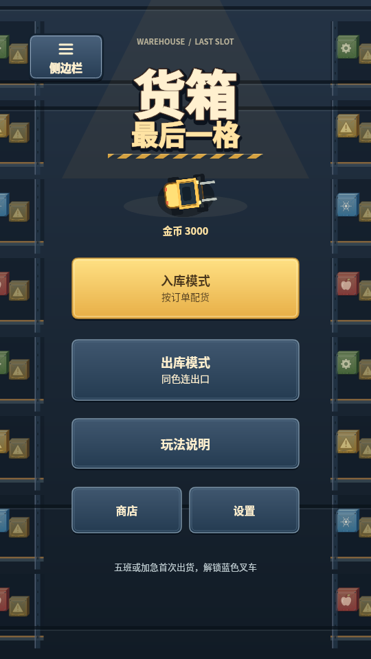

# 抖音开发包导入说明

这份交付是抖音小游戏项目目录，**不是 Android APK**。

1. 解压交付的抖音开发包 ZIP。
2. 在抖音开发者工具中导入解压目录。正确的项目根目录直接包含 `game.js`、`game.json`、`project.config.json` 和 `assets/`，不要选外层下载文件夹，也不要选择原微信/Android目录。
3. 配置已填入用户提供的真实 AppID：`ttfa0f8cb26476311702`。不需要提供 AppSecret。
4. 先在 IDE 检查单包大小和首页，再分别使用 Android 与 iOS 的抖音真机预览。

## 首次检查

- 原标题、入库/出库、玩法说明、商店、设置及底部文字保持不变。
- 左上新增已确认的“侧边栏”入口。只有完整点击才检测并尝试跳转；失败或 8 秒未返回时可在按钮内重试，不会自动跳转，不发游戏奖励。
- 试点击、拖动、取消触摸、切后台/回前台、退出后重开，核对存档与输入。
- 对全部场景与外观进行冷启动、切换及快速连续操作，特别检查门口的旋转叉车/出库货物边界。
- 13 种音效直接使用 common 原 WAV，统一播放 volume=1，不设按钮专用系数；BGM 保留公共音乐设置。需在同系统音量条件下分别听测 Android/iOS，之后才调整抖音独立音量。

## 当前验证边界

本地已验证实际 `game.js` 的模拟 tt 宿主运行、输入/存档、静态资源、侧边栏交互及 Canvas 像素回归。**抖音 IDE 与 Android/iOS 真机尚未运行**，这些是下一步验收，不能用模拟截图替代。

游戏存档位于该抖音小游戏自己的本地存储，不自动继承浏览器、微信或 Android 版本。没有注册、上传、提审或发布。

## 实际候选包首页

下图来自最终实际 `game.js` 在模拟宿主中的渲染，fixture 金币为 3000。它用于对照已批准入口的位置和现有 UI，**不是抖音 IDE 或真机截图**。

